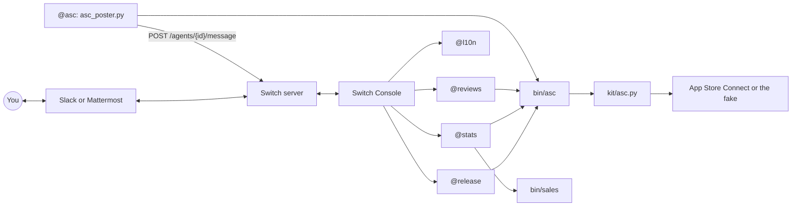

# Architecture

Console runs the four Claude Code agents on your Mac, each in its own folder under `agents/`. `@asc` is a plain script: it polls through `bin/asc`, and posts over HTTP.

## Life of a release

| Checklist step | What happens | Switch feature |
| --- | --- | --- |
| 1 to 2, notes | `@release` reads the commits since the live build, drafts What's New, saves the approved text, and updates the App Review notes and description | Room document `whats-new-<version>` |
| 3, translation | `@release` mentions `@l10n`, which translates and asks you to check your language | Agent-to-agent mention, Who can talk to your agent |
| 4, build | `@release` checks for a VALID build. If there's none, it bumps the version and uploads, each after an Allow, then waits for `@asc` | In-room Allow / Decline, custom agent posting into the room |
| 5 to 7, writes | Dry run, then `--apply`, which pauses for you | In-room Allow / Decline |
| 8, waiting | Nobody needs to watch. `@asc` posts when Apple moves, and that starts `@release`'s next turn | A mention starts a turn |
| 9, rejection | You paste Apple's text, and `@release` matches it against `past-rejections` | Room document |
| 10, release | Final Allow, then a recap | In-room Allow / Decline |

The full text is in [`room/docs/release-checklist.md`](../room/docs/release-checklist.md).

## Why it's built this way

**Agents are addressed by name, not role.** Switch roles looked ideal (`@release-manager`), but the same agents serve every app room and an agent can hold only one role at a time. In a second room, the roles had no holder. An exclusive role's lease also ends shortly after its session disconnects, which is a poor fit for `@asc` posting a day later. Names always resolve, and a session starts when one is needed. Checked on Switch 0.31.

**`@stats` and `@reviews` are separate agents.** Permissions belong to an agent, so splitting them keeps each one small. `@stats` has no write at all, so a question can't turn into a write. `@reviews` has exactly one, because replies are public. `@release` can submit an app, and it has no access to reviews, so it never handles a stranger's text.

**`@asc` only reports.** It has no session and no WebSocket, so it can't be talked into doing anything. It registers as `session_passive`, which is why Switch always shows it as awaiting a manual poll. `@release` treats its posts as state reports, not instructions: when `@asc` itself asked `@release` to change the room's setup, `@release` refused and asked the person.

**`bin/asc` is the only door to Apple.** It reads `.env` so agents never have to, and it limits each agent to its own commands, based on the folder the agent runs from.

**Dry run and `--apply` are separate commands, never chained.** The `ask` rule matches `--apply`, so the Allow request shows exactly what will run. The tool refuses abbreviated flags, because `--app` would otherwise mean `--apply` without matching the rule.

**A build always matches committed code.** `bin/upload` refuses a repo with uncommitted changes, and `bin/bump`'s commit holds only the version files and the release text, and its dry run lists them, so an agent can't ship or sweep up someone's unfinished work. The agents themselves can't commit. The upload steps are the ones that shipped real builds by hand before this repo existed.

**The sandbox and deny rules are both needed.** During testing, Auto mode let an agent search other projects to answer a question about the demo app: `additionalDirectories` isn't a boundary. Claude Code's sandbox stops shell commands, but not the Read and Edit tools, so [`lock_agents.py`](../lock_agents.py) writes both layers.

**The poster doesn't lose an event to an outage.** Apple's state moves on as soon as a change is read, so each post goes into `state/outbox.jsonl` first and leaves only when Switch accepts it. Posts are retried if Switch is down or the key is wrong, and dropped with a log line only if Switch says the post itself is bad, such as a deleted room. The first poll only records, so a fresh start doesn't replay history.

**One event, one post, and only some wake an agent.** Apple often changes the version and the review submission together, so `@asc` joins them. It mentions `@release` only for states the checklist waits for. Others, like IN_REVIEW, are posted for the room with no mention, so they cost no turn.

**The kit has a fake.** [`kit/fake_asc.py`](../kit/fake_asc.py) implements the same endpoints against a JSON file, and `advance` plays Apple one step. That's what makes the demo possible with no Apple account, and it's what the tests run against.

## Files

| Path | What it is |
| --- | --- |
| `agents/<name>/AGENTS.md` | Each agent's standing instructions. `CLAUDE.md` beside it just imports this file |
| `agents/<name>/.claude/settings.json` | Its permission rules: `allow`, `ask`, `deny` |
| `agents/<name>/.claude/settings.local.json` | Generated by `lock_agents.py`, git-ignored: the sandbox and this machine's paths |
| `room/template.yaml`, `room/docs/` | The room template, and the documents `save_template.py` embeds in it |
| `bin/asc`, `bin/sales`, `bin/bump`, `bin/upload` | What agents call. `common.py` holds what they share |
| `kit/` | App Store Connect commands, the fake, fixtures and their test |
| `setup_app.py` | `make setup`: sets it up for your own apps |
| `asc_poster.py`, `register_asc.py` | `@asc` itself, and its one-time registration |
| `switch_op.py` | Calls any Switch operation as `@asc`, for example `list_all_rooms` |
| `demo/` | Demo setup and invented sales. `demo/DemoCam` is generated |
| `state/`, `apps.json`, `rooms.json`, `.env` | Generated and git-ignored: poster state, the fake's state, the sales cache, your apps, your rooms and your keys |
